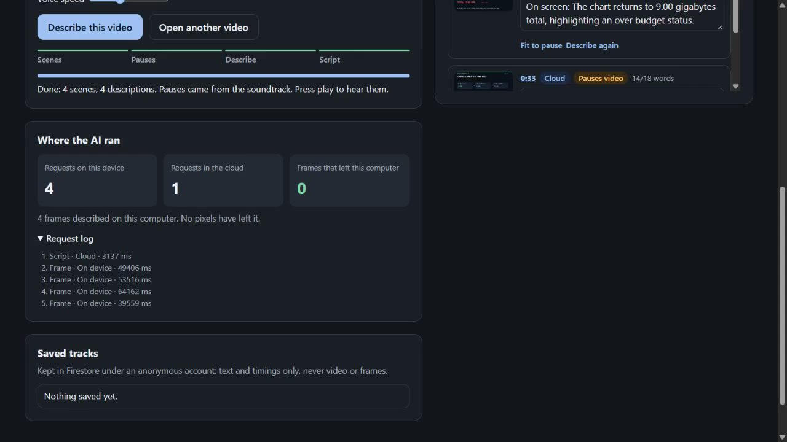

# Seen Aloud

**Audio description for any video, written by Gemini Nano on your own computer, with the cloud as a backup.**

Roughly 2.2 billion people live with a vision impairment, and almost no everyday video (course lectures, family clips, product demos, local news) has an audio description track. Human description costs real money per minute, and cloud tools ask you to upload the whole video. Seen Aloud takes a different route: the frames are described by **Gemini Nano inside Chrome**, so the pictures stay on your computer, and only *text* is sent to Gemini in the cloud when it helps to write the final track.

**Who needs it.** People who publish video but cannot pay for human description or upload private footage: a lecturer recording a course, a city council posting a public meeting, a small team shipping a product demo. For many of them it is a legal duty, not a nice-to-have: audio description for prerecorded video is WCAG success criterion 1.2.5 (Level AA), which EU public-sector sites must meet through EN 301 549, and which US state and local governments must meet under the 2024 ADA Title II rule (WCAG 2.1 AA, from April 2026 for larger entities). Seen Aloud gives them a first draft track in minutes that a person reviews and edits, instead of no track at all.

Built for the #BuildHybridAI 2026 hackathon on **Firebase AI Logic hybrid inference** (platform: Web / Chrome).

**Live demo:** https://seen-aloud.web.app (desktop Chrome 139+; Gemini Nano is optional, the app asks before using the cloud for frames).



*After describing a 45-second explainer: Gemini Nano described every frame on the computer, Gemini in the cloud wrote the final script from text only, and no frame left the machine.*

## What it does

1. **Finds scenes** locally (no AI): samples the video, compares frames, cuts at changes, splits long static shots.
2. **Finds pauses**: from your captions (WebVTT/SRT) if you have them, otherwise by listening for quiet stretches in the soundtrack. A description is only placed where nobody is talking.
3. **Describes each scene** by sending one key frame to Gemini Nano through Firebase AI Logic (`PREFER_ON_DEVICE`). The prompt carries the previous scene so the narration stays coherent.
4. **Writes the track**: one text-only request (`PREFER_IN_CLOUD`) sees every scene's notes, the on-screen text, the dialogue and each pause's word budget, and writes a consistent narration. Lines that still do not fit are shortened on the device.
5. **Plays it**: the built-in player speaks each description with the browser's voice, ducks the soundtrack, and **pauses the video** for descriptions longer than their pause (extended audio description, WCAG 2.2 SC 1.2.7).
6. **Exports** a `WebVTT` description track (`<track kind="descriptions">`) and a plain script, and lets you edit every line.

## How it uses Firebase AI Logic hybrid inference

Each task gets its own `getGenerativeModel` instance with its own `InferenceMode` ([src/ai/firebaseProvider.ts](src/ai/firebaseProvider.ts), policy in [src/ai/engine.ts](src/ai/engine.ts)):

| Task | Mode | Why |
| --- | --- | --- |
| Describe a frame (image + text) | `PREFER_ON_DEVICE` | Many small calls; the frames are the private part of the video, and on-device is free. |
| Write the whole track (text only) | `PREFER_IN_CLOUD` | Needs every scene at once, more than Nano comfortably holds. Only text leaves the device. |
| Fit a line to its pause | `PREFER_ON_DEVICE` | Tiny rewrite, no reason to pay or wait for the network. |
| **Private** mode | `ONLY_ON_DEVICE` | Nothing is ever sent to the cloud. |
| **Cloud** mode | `ONLY_IN_CLOUD` | For machines without Gemini Nano. |

Details that matter in practice:

- **One JSON Schema, two paths.** The same schema is passed as `onDeviceParams.promptOptions.responseConstraint` and `inCloudParams.generationConfig.responseJsonSchema`, so on-device and cloud answers have the same shape.
- **The privacy promise is enforced, not assumed.** The SDK falls back to the cloud when Chrome has no `LanguageModel` at all, even in `ONLY_ON_DEVICE`. The engine checks availability first and refuses to run in Private mode without Nano (`PrivacyGuardError`). In Hybrid mode, if frames would have to go to the cloud, the person is asked once per video.
- **Mid-request failures are handled.** The SDK only falls back when Nano is unavailable *before* the call; if Nano accepts a request and then fails, the engine retries it in the cloud with the same consent rules.
- **A visible ledger** shows requests on device vs. in the cloud, and the number of frames that left the computer, using `response.inferenceSource`.
- **Download on a user gesture.** `initializeDeviceModel()` runs from a button click with a progress callback.

Other Firebase products:

- **App Check** (required): reCAPTCHA Enterprise in production, the debug provider on localhost ([src/firebase/client.ts](src/firebase/client.ts)).
- **Remote Config**: cloud model name, scene sensitivity, words-per-second, house-style notes, all validated and clamped ([src/config/settings.ts](src/config/settings.ts)), so the cloud model can be swapped without a redeploy.
- **Authentication** (anonymous) + **Firestore**: saved tracks (text and timings only, never video or frames), protected by [firestore.rules](firestore.rules).

## Run it

Requirements: Node 20+, Chrome 139+ on desktop. Gemini Nano is optional (the cloud path works without it).

```bash
npm install
cp .env.example .env.local   # fill in your Firebase web app config
npm run dev                  # http://localhost:5173
```

### Firebase setup (about 10 minutes)

1. Create a Firebase project and a **Web app**; paste its config into `.env.local`.
2. **AI Logic** → Get started → choose the **Gemini Developer API** (free tier is enough).
3. **App Check** → register the web app with reCAPTCHA Enterprise (put the site key in `.env.local`) and enforce it for Firebase AI Logic. For local development, run the app once, copy the debug token printed in the browser console, and add it under *Manage debug tokens*. Never commit it.
4. **Authentication** → enable the *Anonymous* provider.
5. **Firestore** → create a database and deploy [firestore.rules](firestore.rules).
6. (Optional) **Remote Config** → add `cloud_model`, `scene_threshold`, `words_per_second`, `style_notes`.

### Enable Gemini Nano in Chrome

Open `chrome://flags`, set **Prompt API** and **Prompt API Multimodal Input** to *Enabled* (and **Gemma 4 for Built-in AI** if listed), restart Chrome, then press **Download Gemini Nano** in the app header. The model is several GB. Without it, Hybrid mode asks before using the cloud.

### Try it

`npm run sample` (needs ffmpeg) creates `samples/demo.mp4`, a short video with three distinct scenes and pauses. Any MP4/WebM works.

## Tests

```bash
npm test         # 80 tests: scene detection, pause detection, word budgets, WebVTT, parsers, the hybrid policy, cloud retry
npm run typecheck
```

The hybrid policy tests run the real engine against a fake provider that behaves like the SDK's routing, covering the privacy guard, consent, fallback and ledger.

## Accessibility

The people this is for use screen readers, so the app itself has to work with one.

- **Checked:** axe-core 4.10 reports no violations on the start screen; the whole flow runs from the keyboard (skip link, mode radios, language, file pickers, Describe, player, every line); progress, errors and the device status are live regions; each scene's line, its word counter ("too long for the pause" is announced) and its Fit / Describe again buttons name the scene they belong to; saved tracks name the track in Load / Delete.
- **Not yet:** a session with blind or low-vision users, and a full screen-reader run with NVDA or VoiceOver. Those come before any claim that it is easy to use.

## Layout

```
src/ai/        Firebase AI Logic provider, hybrid policy, prompts, schemas, parsers
src/media/     scene cuts, soundtrack pauses, caption gaps, frame capture (all local)
src/track/     word budgets, WebVTT/SRT, script export
src/player/    voiced playback with extended-description pauses
src/firebase/  App Check, Auth, Firestore, Remote Config
src/config/    settings and their Remote Config bounds
tests/         vitest
```

## What was built during the contest period

Everything in this repository was written for #BuildHybridAI 2026 starting 11 Nov 2026. It was developed with Claude Code as the coding assistant. No pre-existing application code is included. Third-party code: the Firebase JS SDK (Apache 2.0).

## License

Apache 2.0, see [LICENSE](LICENSE).
